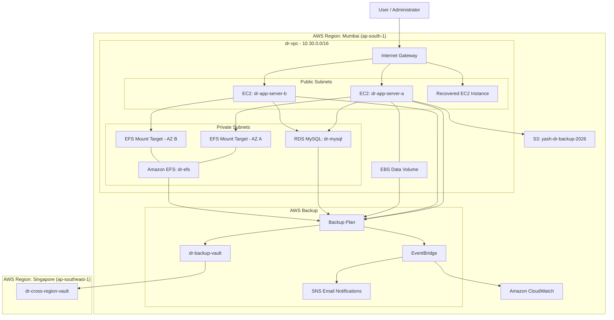

# AWS Backup, Disaster Recovery and Business Continuity

A hands-on AWS infrastructure project focused on protecting application infrastructure and business data through automated backups, recovery points, cross-Region backup copies, and disaster recovery testing.

---

## Project Overview

This project demonstrates how to design and implement a backup and disaster recovery environment using Amazon Web Services (AWS).

The infrastructure includes application servers, block storage, shared file storage, object storage, a relational database, centralized backup management, and recovery mechanisms.

The primary objective is to reduce the risk of data loss and improve application recovery after infrastructure failures or accidental data deletion.

**Project Region:** Asia Pacific (Mumbai) – `ap-south-1`  
**Disaster Recovery Region:** Asia Pacific (Singapore) – `ap-southeast-1`  
**Repository:** [aws-backup-disaster-recovery](https://github.com/yash-jogdand/aws-backup-disaster-recovery)

## Project Objectives

- Deploy application servers using Amazon EC2.
- Attach and configure Amazon EBS volumes.
- Configure shared storage using Amazon EFS.
- Store important files in Amazon S3.
- Deploy a private Amazon RDS MySQL database.
- Automate EBS snapshots and manage EC2 AMIs.
- Centralize backups using AWS Backup.
- Configure backup vaults, schedules, and retention policies.
- Enable S3 versioning and lifecycle management.
- Configure cross-Region backup copies.
- Test EC2, EBS, and RDS recovery procedures.
- Monitor backup operations and configure email notifications.

## AWS Services Used

| Category | AWS Service | Purpose |
|---|---|---|
| Networking | Amazon VPC | Isolated project network |
| Networking | Subnets | Separate public and private network segments |
| Networking | Internet Gateway | Internet connectivity for public subnets |
| Networking | Security Groups | Control inbound and outbound traffic |
| Compute | Amazon EC2 | Application servers |
| Compute | Amazon Machine Images | EC2 recovery through machine images |
| Block Storage | Amazon EBS | Persistent block storage |
| File Storage | Amazon EFS | Shared file storage across EC2 instances |
| Object Storage | Amazon S3 | Important file storage and versioning |
| Database | Amazon RDS for MySQL | Managed relational database |
| Backup | AWS Backup | Centralized backup management |
| Backup | EBS Snapshots | Point-in-time volume backups |
| Monitoring | Amazon CloudWatch | AWS monitoring and metrics |
| Event Management | Amazon EventBridge | Backup, copy, and restore job events |
| Notifications | Amazon SNS | Email notifications |
 
## Architecture Overview

The project uses a VPC in the Mumbai Region with public and private subnets across two Availability Zones.

Application EC2 instances are deployed in public subnets. RDS is deployed privately. EFS provides shared file storage through mount targets in the private subnets. S3 stores important files independently of the EC2 instances.

AWS Backup manages recovery points in the Mumbai backup vault. A cross-Region copy configuration sends supported backup recovery points to a separate vault in Singapore.

### Architecture Diagram



*The diagram represents the implemented service relationships and intended backup flow. It is a logical overview, not a literal network routing diagram.*

## Backup and Recovery Strategy

| Resource | Protection Method | Recovery Method |
|---|---|---|
| EC2 | AWS Backup and AMI | Restore EC2 from AMI or backup |
| EBS | Manual snapshots, lifecycle policy and AWS Backup | Restore a new EBS volume |
| EFS | AWS Backup | Restore from an EFS recovery point |
| S3 | Versioning and lifecycle management | Recover an earlier object version |
| RDS MySQL | Automated backups, manual snapshot and AWS Backup | Restore a database instance from snapshot |
| Regional backups | AWS Backup copy configuration | Use recovery points in Singapore |

## Implementation Details

### 1. Networking

- VPC: `dr-vpc`
- CIDR: `10.30.0.0/16`
- Public subnets in two Availability Zones.
- Private subnets in two Availability Zones.
- Internet Gateway attached to the VPC.
- Separate public and private route tables.
- Security groups controlling application, SSH, and database access.

### 2. Compute

- Amazon Linux 2023 EC2 application servers.
- Apache web server installed.
- Application page deployed and verified.
- EC2 AMI created for recovery testing.
- A separate recovered EC2 instance launched from the AMI.

### 3. EBS

- Encrypted 5 GiB gp3 data volume.
- XFS file system mounted at `/data`.
- Persistent mount configured.
- Manual snapshot created.
- EBS Lifecycle Manager policy configured for daily snapshots with seven-snapshot retention.
- AWS Backup recovery point restored to a separate volume.

### 4. EFS

- Regional encrypted EFS file system.
- Mount targets configured in two Availability Zones.
- NFS access controlled through a security group.
- Shared file successfully created on one EC2 instance and read from another.
- AWS Backup assignment and on-demand backup configured.

### 5. S3

- Bucket: `yash-dr-backup-2026`
- Public access blocked.
- Server-side encryption enabled using SSE-S3.
- Versioning enabled.
- Lifecycle rule configured:
  - Current objects transition to Standard-IA after 30 days.
  - Noncurrent versions expire after 30 days.
  - Expired delete markers are removed.
- Multiple versions of an object uploaded and verified.

### 6. RDS

- Engine: MySQL.
- Instance: `dr-mysql`.
- Instance class: `db.t3.micro`.
- Storage: 20 GiB gp3.
- Single-AZ deployment.
- Private database access.
- Encryption enabled.
- Automated backup retention configured for one day.
- Deletion protection enabled on the original database.
- Manual snapshot created and restored to a separate test instance.

**Database test limitation:** No application database or application records were created in the original RDS instance. The restore exercise therefore verifies infrastructure restoration, not application-data recovery.

### 7. AWS Backup

- Primary vault: `dr-backup-vault`.
- Cross-Region vault: `dr-cross-region-vault`.
- Backup plan: `dr-backup-plan`.
- Backup rule: `dr-daily-backup`.
- Backup frequency: Hourly, starting at 3:00 PM Asia/Calcutta.
- Backup start window: One hour.
- Backup completion window: Two hours.
- Recovery point retention: Seven days.
- Cross-Region copy destination: Singapore.
- Cross-Region copy retention: Seven days.
- Separate resource assignments for EFS and other protected resources.

### 8. Monitoring and Notifications

- Amazon CloudWatch used to inspect AWS Backup metrics.
- EventBridge rule: `dr-backup-notification-rule`.
- Configured event types:
  - Backup Job State Change
  - Copy Job State Change
  - Restore Job State Change
- SNS topic: `dr-backup-alerts`.
- Email subscription confirmed.
- Backup email notification received and verified.

## Testing and Validation

The following implementation checks were performed:

| Test | Result |
|---|---|
| EC2 application deployment | Verified |
| EBS volume attachment and mount | Verified |
| EBS snapshot creation | Verified |
| EBS recovery volume restoration | Restored volume mounted; final content verification pending |
| EC2 AMI creation | Verified |
| EC2 recovery instance launch | Verified |
| EC2 failure recovery exercise | Performed |
| EFS shared file access | Verified |
| EFS backup job | Completed successfully |
| S3 object versioning | Verified |
| RDS snapshot restoration | Restore instance became Available |
| AWS Backup EC2 jobs | Completed successfully |
| AWS Backup EBS jobs | Completed successfully |
| AWS Backup RDS jobs | Completed successfully |
| Cross-Region EBS copy | Singapore recovery point verified |
| SNS email notification | Received and verified |

## Security Considerations

- S3 public access is blocked.
- EBS, EFS, and RDS encryption are enabled.
- RDS is not publicly accessible.
- Database access is restricted through security groups.
- EFS NFS access is restricted to the application security group.
- SSH access is restricted to the administrator's IP address.
- RDS deletion protection is enabled on the original database.
- Backup retention and recovery points are managed separately from the original resources.

## Cost Considerations

This project uses AWS resources that may incur charges, including:

- EC2 instance running time.
- EBS storage and snapshots.
- EFS storage and mount targets.
- RDS instance running time and storage.
- S3 storage and object versions.
- AWS Backup storage and cross-Region copies.
- Data transfer and other applicable service charges.

Review AWS Billing and Cost Explorer regularly. Remove temporary recovery resources after completing the required tests and documentation.

## Repository Structure

```text
aws-backup-disaster-recovery/
│
├── architecture/
├── networking/
├── compute/
├── storage/
├── database/
├── backup/
├── disaster-recovery/
├── monitoring/
├── implementation/
├── testing/
├── screenshots/
├── resources/
│
└── README.md
```

Detailed documentation for each component will be maintained in its respective directory.

## Learning Outcomes

Through this project, the following AWS concepts and practical skills are demonstrated:

- Designing VPC-based infrastructure.
- Deploying and managing EC2 instances.
- Configuring EBS and EFS storage.
- Implementing S3 versioning and lifecycle rules.
- Deploying private RDS databases.
- Creating snapshots and AMIs.
- Managing centralized backups with AWS Backup.
- Configuring cross-Region recovery points.
- Performing infrastructure recovery exercises.
- Integrating EventBridge, CloudWatch, and SNS.

## Project Status

The core AWS infrastructure and major backup and recovery exercises have been implemented. Detailed component documentation, final verification, and repository auditing are being completed.

## Author

**Yash Satyavan Jogdand**

GitHub: [yash-jogdand](https://github.com/yash-jogdand)

---

*This repository documents a hands-on AWS learning project. Resource configurations and test results are based on the actual implementation and verification performed in AWS.*