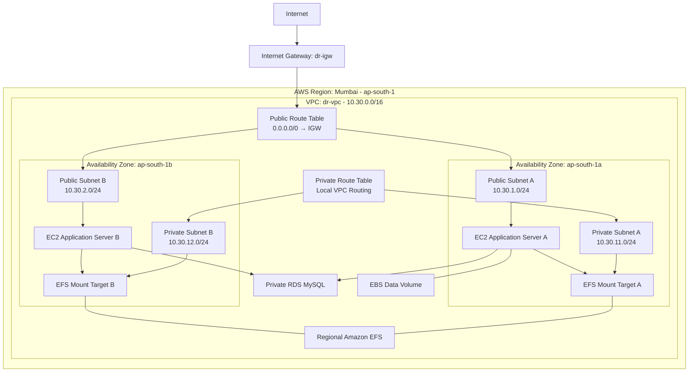
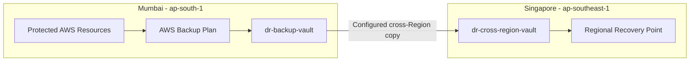

# AWS Infrastructure Architecture

## 1. Overview

This document describes the architecture of the AWS Backup, Disaster Recovery and Business Continuity project.

The infrastructure is deployed primarily in the Mumbai AWS Region (`ap-south-1`). A separate backup vault is configured in Singapore (`ap-southeast-1`) to support cross-Region disaster recovery.

The architecture combines network isolation, application compute, persistent storage, database services, centralized backup management and recovery capabilities.

## 2. Architecture Objectives

- Establish an isolated AWS network.
- Deploy application servers across two Availability Zones.
- Separate public application infrastructure from private database infrastructure.
- Provide persistent block storage and shared file storage.
- Protect important objects using Amazon S3 versioning.
- Centralize backup operations through AWS Backup.
- Maintain backup copies in a separate AWS Region.
- Support infrastructure recovery after failures.

## 3. AWS Region and Network Configuration

### Primary Region

| Property | Configuration |
|---|---|
| AWS Region | Asia Pacific (Mumbai) |
| Region code | `ap-south-1` |
| VPC name | `dr-vpc` |
| VPC CIDR | `10.30.0.0/16` |
| Internet Gateway | `dr-igw` |
| Public route table | `dr-public-rt` |
| Private route table | `dr-private-rt` |

### Subnet Configuration

| Subnet | CIDR | Availability Zone | Type |
|---|---|---|---|
| `dr-public-a` | `10.30.1.0/24` | `ap-south-1a` | Public |
| `dr-public-b` | `10.30.2.0/24` | `ap-south-1b` | Public |
| `dr-private-a` | `10.30.11.0/24` | `ap-south-1a` | Private |
| `dr-private-b` | `10.30.12.0/24` | `ap-south-1b` | Private |

### Routing Configuration

**Public route table – `dr-public-rt`**

- Associated with both public subnets.
- Default route `0.0.0.0/0` points to `dr-igw`.
- Public subnets have automatic public IPv4 assignment enabled.

**Private route table – `dr-private-rt`**

- Associated with both private subnets.
- No NAT Gateway default route is configured.
- Private subnet resources use the VPC's local routing for internal communication.

The project does not use a NAT Gateway.

## 4. Network Architecture Diagram

*The diagram is a logical representation of the deployed network. It does not represent every individual AWS route or security-group rule.*

## 5. Compute Architecture

Application compute uses Amazon EC2 with Amazon Linux 2023.

| Resource | Purpose |
|---|---|
| `dr-app-server-a` | Primary application server |
| `dr-app-server-b` | Second application server and shared-storage testing |
| `dr-recovered-server` | Recovery instance launched from the application AMI |

Apache is installed on the application servers to serve a basic application page.

An Amazon Machine Image was created from the primary application server and used to launch the recovered EC2 instance.

## 6. Storage Architecture

### Amazon EBS

- A 5 GiB encrypted gp3 data volume is attached to the primary application server.
- The XFS file system is mounted at `/data`.
- A manual snapshot was created.
- EBS Lifecycle Manager manages daily snapshots with a seven-snapshot retention setting.
- AWS Backup was also used to create and restore an EBS recovery point.

### Amazon EFS

- Regional EFS file system: `dr-efs`.
- Encryption at rest enabled.
- Mount targets configured in two Availability Zones.
- NFS access allowed from the application EC2 security group.
- Shared file access tested between two EC2 instances.

### Amazon S3

- Bucket: `yash-dr-backup-2026`.
- Public access blocked.
- SSE-S3 encryption enabled.
- Versioning enabled.
- Lifecycle management configured for current and noncurrent object versions.

## 7. Database Architecture

Amazon RDS for MySQL is deployed inside the private subnets.

| Property | Configuration |
|---|---|
| DB identifier | `dr-mysql` |
| Engine | MySQL |
| Instance class | `db.t3.micro` |
| Storage | 20 GiB gp3 |
| Deployment | Single-AZ |
| Public access | Disabled |
| Encryption | Enabled |
| Automated backup retention | 1 day |
| Deletion protection | Enabled on original database |

A manual database snapshot was created and restored to a separate test instance named `dr-mysql-restore-test`.

No application database or application records were created in the original RDS instance. The restore exercise verified restoration of the database infrastructure, not recovery of application records.

## 8. Security Architecture

The project uses separate security groups for application servers, EFS and RDS.

| Security group | Purpose | Important inbound access |
|---|---|---|
| `dr-ec2-sg` | Application EC2 instances | SSH from administrator IP; HTTP from administrator IP |
| `dr-efs-sg` | EFS mount targets | NFS TCP 2049 from `dr-ec2-sg` |
| `dr-rds-sg` | RDS MySQL | MySQL TCP 3306 from `dr-ec2-sg` |

Security considerations:

- RDS is not publicly accessible.
- Database access is restricted to the application security group.
- EFS NFS access is restricted to the application security group.
- SSH access is restricted to the configured administrator IP.
- S3 public access is blocked.
- Storage encryption is enabled where configured.

## 9. Backup Architecture

AWS Backup provides centralized backup management.

| Component | Name |
|---|---|
| Backup plan | `dr-backup-plan` |
| Backup rule | `dr-daily-backup` |
| Primary vault | `dr-backup-vault` |
| Cross-Region vault | `dr-cross-region-vault` |
| EFS assignment | `dr-efs-backup-assignment` |
| Main assignment | `dr-backup-resources` |

### Backup Schedule

| Setting | Configuration |
|---|---|
| Frequency | Hourly |
| Starting time | 3:00 PM Asia/Calcutta |
| Start window | 1 hour |
| Completion window | 2 hours |
| Retention | 7 days |
| Primary vault | `dr-backup-vault` |

The backup rule also contains a cross-Region copy configuration for Singapore, with seven-day copy retention.

The backup assignment includes EC2, EBS and RDS resources. EFS has a separate resource assignment.

### Cross-Region Architecture

The Singapore recovery point for the EBS backup was verified as available. Do not assume every resource type has a verified cross-Region copy.

## 10. Monitoring and Notification Architecture

The project uses:

- Amazon CloudWatch for monitoring and metrics inspection.
- Amazon EventBridge for AWS Backup job state-change events.
- Amazon SNS for email notifications.

EventBridge rule: `dr-backup-notification-rule`

Configured event types:

1. Backup Job State Change
2. Copy Job State Change
3. Restore Job State Change

SNS topic: `dr-backup-alerts`

The email subscription was confirmed, and an email notification was received after a completed backup job.

## 11. Disaster Recovery Workflow

The implemented recovery exercises include:

### EC2 Recovery

1. Create an AMI from the application server.
2. Launch a separate recovery EC2 instance from the AMI.
3. Verify the recovered application server.
4. Stop the original server for a recovery exercise.
5. Verify the recovered application remains available.
6. Restart the original server.

### EBS Recovery

1. Create a backup recovery point.
2. Restore the recovery point as a separate EBS volume.
3. Attach the restored volume.
4. Mount the restored file system separately.
5. Inspect the restored data without modifying the original volume.

### RDS Recovery

1. Create a manual RDS snapshot.
2. Restore the snapshot to a separate database instance.
3. Verify the restored instance becomes Available.

The original RDS instance is kept separate and is not modified as part of the restore exercise.

## 12. Architecture Limitations

The following distinctions are important:

- The application uses basic Apache content rather than a production multi-tier application.
- The RDS instance is Single-AZ, not a Multi-AZ deployment.
- No NAT Gateway is configured.
- The cross-Region EBS recovery point was verified; equivalent copy verification for every protected resource is not claimed.
- The RDS restore test did not demonstrate recovery of application records because no application database or records were created.
- CloudWatch metrics inspection was performed, but a dedicated CloudWatch dashboard or alarm configuration is not claimed here.

## 13. Related Documentation

- [Project Overview](../README.md)
- [Networking Documentation](../networking/README.md)
- [Compute Documentation](../compute/README.md)
- [Storage Documentation](../storage/README.md)
- [Database Documentation](../database/README.md)
- [Backup Documentation](../backup/README.md)
- [Disaster Recovery Documentation](../disaster-recovery/README.md)
- [Monitoring Documentation](../monitoring/README.md)

---

**Document:** AWS Infrastructure Architecture  
**Project:** AWS Backup, Disaster Recovery and Business Continuity  
**Primary Region:** `ap-south-1`  
**Disaster Recovery Region:** `ap-southeast-1`