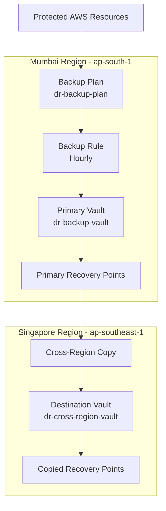

# AWS Backup – Centralized Backup and Cross-Region Protection

## 1. Overview

This document describes the centralized backup infrastructure implemented for the AWS Backup, Disaster Recovery and Business Continuity project.

AWS Backup is a managed service that centralizes and automates data protection across supported AWS services.

The project uses AWS Backup to protect EC2 instances, EBS volumes, Amazon EFS and Amazon RDS resources. A backup plan defines the schedule and retention period, while a copy action provides cross-region backup protection.

## 2. Objectives

- Configure AWS Backup for centralized backup management.
- Create primary and cross-region backup vaults.
- Configure an automated backup plan.
- Define backup schedules and retention policies.
- Assign EC2, EBS, EFS and RDS resources.
- Monitor backup job status.
- Configure cross-region backup copying.
- Verify recovery points in the destination region.

## 3. AWS Services Used

| Service | Purpose |
|---|---|
| AWS Backup | Centralized backup management |
| Backup Vault | Stores backup recovery points |
| Backup Plan | Defines backup schedule and retention |
| Backup Rule | Defines when backups run and where they are stored |
| Backup Assignment | Selects protected AWS resources |
| IAM | Provides permissions for backup operations |
| AWS Regions | Support cross-region backup protection |

## 4. Backup Vault Configuration

Two backup vaults were configured.

### 4.1 Primary Backup Vault

| Property | Configuration |
|---|---|
| Vault name | `dr-backup-vault` |
| Region | `ap-south-1` |
| Purpose | Stores primary backup recovery points |
| Encryption | Default AWS Backup encryption |

The primary vault stores recovery points created by the project's backup plan.

### 4.2 Cross-Region Backup Vault

| Property | Configuration |
|---|---|
| Vault name | `dr-cross-region-vault` |
| Region | `ap-southeast-1` |
| Destination | Singapore |
| Purpose | Stores copied recovery points |

The destination vault provides an additional recovery location outside the primary Mumbai Region.

## 5. AWS Backup Service Opt-In

AWS Backup service opt-in settings were enabled for the services used in the project:

- Amazon EC2
- Amazon EBS
- Amazon EFS
- Amazon RDS
- Amazon S3

The configured resource assignments and completed backup jobs are documented separately from the service opt-in settings.

## 6. Backup Plan Configuration

**Backup plan name:** `dr-backup-plan`

A backup plan was created to automate recurring backups.

### 6.1 Backup Rule

**Rule name:** `dr-daily-backup`

| Property | Configuration |
|---|---|
| Backup plan | `dr-backup-plan` |
| Rule | `dr-daily-backup` |
| Primary vault | `dr-backup-vault` |
| Schedule | Hourly |
| Start time | 3:00 PM Asia/Calcutta |
| Frequency | Every 1 hour |
| Start window | 1 hour |
| Completion window | 2 hours |
| Retention | 7 days |

The schedule is intentionally configured as hourly. The rule starts at 3:00 PM Asia/Calcutta and repeats every hour according to the configured schedule.

### 6.2 Backup Retention

The backup rule retains recovery points for seven days.

Retention controls how long the recovery points remain available before they are eligible for expiration under the configured lifecycle settings.

## 7. Cross-Region Copy Configuration

A copy action was configured in the backup rule.

| Property | Configuration |
|---|---|
| Source vault | `dr-backup-vault` |
| Destination vault | `dr-cross-region-vault` |
| Destination Region | `ap-southeast-1` |
| Destination location | Singapore |
| Copy retention | 7 days |

### Purpose

Cross-region backup copying helps protect recovery points against a failure affecting the primary AWS Region.

It provides a separate regional recovery location rather than keeping all backup copies in Mumbai.

The destination recovery points can be used for supported restore operations in the destination Region.

**Verification scope:** A cross-region EBS recovery point was verified as Available in Singapore. This document does not claim that every service's recovery point was independently verified in the destination Region.

## 8. Backup Resource Assignments

Resource assignments determine which AWS resources are protected by the backup plan.

The project uses the IAM role:

`AWSBackupDefaultServiceRole`

### 8.1 Main Resource Assignment

**Assignment name:** `dr-backup-resources`

The assignment includes the following resource selection:

| Resource type | Selection method |
|---|---|
| EC2 instances | Resource ARN prefix |
| RDS databases | Resource ARN prefix |
| EBS volume | Specific resource ARN |

The assignment uses the following resource patterns:

```text
arn:aws:ec2:*:*:instance/*
arn:aws:rds:*:*:db:*
```

A specific EBS volume was also selected by its resource ARN.

### 8.2 Separate EFS Assignment

A separate EFS resource assignment was configured.

**Assignment name:** `dr-efs-backup-assignment`

This assignment protects the project's EFS file system.

### 8.3 Protected Resource Summary

| AWS resource | Project resource | Backup configuration |
|---|---|---|
| EC2 | `dr-app-server-a` | AWS Backup |
| EC2 | `dr-app-server-b` | AWS Backup |
| EC2 | `dr-recovered-server` | AWS Backup |
| EBS | `dr-app-data` | AWS Backup |
| EFS | `dr-efs` | Separate EFS assignment |
| RDS | `dr-mysql` | AWS Backup |
| RDS | `dr-mysql-restore-test` | AWS Backup |

The resource list reflects the project resources for which completed backup jobs were observed.

S3 versioning and lifecycle management were configured separately. This document does not claim that the S3 bucket was included in the completed AWS Backup resource assignment.

## 9. Backup Workflow



*The diagram illustrates the configured backup and cross-region copy workflow. Actual copied recovery points depend on the supported resource type and completed copy jobs.*

## 10. Backup Job Monitoring

Backup jobs were inspected in the AWS Backup console.

The following project resources had completed backup jobs:

- `dr-app-server-a`
- `dr-app-server-b`
- `dr-recovered-server`
- `dr-app-data`
- `dr-efs`
- `dr-mysql`
- `dr-mysql-restore-test`

The backup job results showed Completed status for the listed resources.

### Backup Job Verification

The following checks were performed:

1. Open the AWS Backup console.
2. Navigate to Backup jobs.
3. Review the backup job history.
4. Confirm the job status.
5. Inspect the protected resource.
6. Review the recovery point in the backup vault.

## 11. Recovery Point Verification

Recovery points were reviewed in the primary backup vault.

A cross-region EBS copy was also inspected in the Singapore Region.

The destination recovery point reached Available status.

This verified the cross-region copy process for the tested EBS recovery point.

## 12. Backup and Recovery Considerations

A reliable backup strategy should consider:

- Backup frequency.
- Recovery Point Objective (RPO).
- Recovery Time Objective (RTO).
- Retention period.
- Encryption.
- IAM permissions.
- Recovery-point availability.
- Cross-region copy status.
- Restore testing.
- Backup storage costs.

A successful backup job does not by itself prove that an application can be fully recovered. Restore testing is required to validate the recovery process.

## 13. Implementation Summary

The following activities were completed:

- Enabled AWS Backup service opt-in for the selected services.
- Created `dr-backup-vault` in Mumbai.
- Created `dr-cross-region-vault` in Singapore.
- Created backup plan `dr-backup-plan`.
- Created hourly backup rule `dr-daily-backup`.
- Configured seven-day backup retention.
- Configured one-hour start window.
- Configured two-hour completion window.
- Configured the Singapore cross-region copy action.
- Created the main resource assignment.
- Created a separate EFS resource assignment.
- Verified completed backup jobs.
- Verified an EBS recovery point copy in Singapore.

## 14. Limitations

- The configured schedule is hourly, which can increase backup activity and storage costs.
- Cross-region recovery-point availability was specifically verified for EBS.
- The project does not claim complete cross-region recovery validation for every protected service.
- Backup completion does not replace application-level restore testing.
- S3 versioning and lifecycle management were configured separately from the documented AWS Backup assignments.

## 15. Related Documentation

- [Project Overview](../README.md)
- [Architecture Documentation](../architecture/aws-architecture.md)
- [Networking Documentation](../networking/README.md)
- [Compute Documentation](../compute/README.md)
- [Storage Documentation](../storage/README.md)
- [Database Documentation](../database/README.md)
- [Disaster Recovery Documentation](../disaster-recovery/README.md)
- [Monitoring Documentation](../monitoring/README.md)

---

**Project:** AWS Backup, Disaster Recovery and Business Continuity  
**Document:** AWS Backup and Cross-Region Protection  
**Primary Region:** `ap-south-1`  
**DR Region:** `ap-southeast-1`