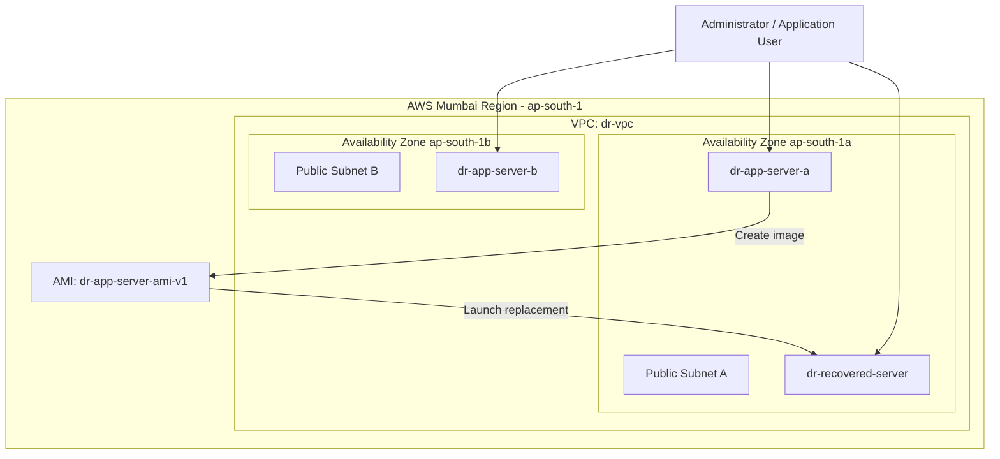

# AWS Compute – EC2 Instances and AMI-Based Recovery

## 1. Overview

This document describes the compute infrastructure implemented for the AWS Backup, Disaster Recovery and Business Continuity project.

Amazon EC2 provides the virtual servers used to host and test the application. Amazon Machine Images (AMIs) provide a way to create a reusable image of an EC2 instance and launch a replacement instance during a recovery exercise.

The project includes two application EC2 instances and one recovered EC2 instance launched from an AMI.

## 2. Objectives

- Deploy application servers across two Availability Zones.
- Configure EC2 instances with Amazon Linux 2023.
- Install and run the Apache web server.
- Create an AMI of an application server.
- Launch a replacement EC2 instance using the AMI.
- Validate application availability during an instance failure simulation.

## 3. AWS Services Used

| Service | Purpose |
|---|---|
| Amazon EC2 | Runs the application servers |
| Amazon Machine Image (AMI) | Provides a reusable EC2 machine image |
| Amazon EBS | Provides persistent block storage for EC2 |
| Amazon VPC | Provides network isolation |
| Security Groups | Control inbound and outbound instance traffic |
| Amazon CloudWatch | Provides AWS resource monitoring capabilities |

## 4. EC2 Infrastructure

Three EC2 instances were used in the project.

| Instance name | Operating system | Instance type | Subnet |
|---|---|---|---|
| `dr-app-server-a` | Amazon Linux 2023 | `t3.micro` | `dr-public-a` |
| `dr-app-server-b` | Amazon Linux 2023 | `t3.micro` | `dr-public-b` |
| `dr-recovered-server` | Amazon Linux 2023 AMI-based launch | `t3.micro` | `dr-public-a` |

The application servers were deployed in separate Availability Zones to distribute the application infrastructure.

The recovered server was launched in the Mumbai Region using the AMI created from the original application server.

## 5. Application Server Configuration

### 5.1 Operating System

The application instances use Amazon Linux 2023.

### 5.2 Instance Type

The configured instance type is:

` t3.micro `

This instance type was selected for the project's learning and testing workload.

### 5.3 Root Storage

The application instances use an 8 GiB General Purpose SSD (`gp3`) EBS root volume.

### 5.4 Security Group

The application instances use:

`dr-ec2-sg`

Configured inbound access:

| Protocol | Port | Source |
|---|---:|---|
| SSH | 22 | Administrator's My IP |
| HTTP | 80 | Administrator's My IP |

### 5.5 Application Setup

Apache HTTP Server was installed and enabled on the application instances.

The application page used for validation contains:

```html
<h1>AWS Disaster Recovery Project</h1>
<h2>Primary Application Server A</h2>
<p>Application is running successfully.</p>
```

The second application server was also configured to serve an application page.

## 6. AMI Creation

An Amazon Machine Image was created from the application server to support recovery.

**AMI name:** `dr-app-server-ami-v1`

The AMI was created with the reboot option enabled.

### Purpose of the AMI

An AMI captures the instance configuration and the associated image data needed to launch another EC2 instance.

It can be used to create a replacement server without repeating the complete operating-system and application installation process.

### AMI-Based Recovery Process

1. Select the application EC2 instance.
2. Create an AMI from the instance.
3. Wait for the AMI status to become Available.
4. Select the AMI as the launch source for a new EC2 instance.
5. Configure the required instance type, network and security group.
6. Launch the recovered instance.
7. Verify that the application is available.

## 7. Compute Architecture Diagram



*The diagram shows the two application servers and the AMI-based replacement server. The recovered server is a separate EC2 instance launched from the AMI.*

## 8. Disaster-Recovery Exercise

A failure simulation was performed to validate the ability to recover the application using the AMI-based replacement instance.

### Exercise Procedure

1. Confirm that the original application server is running.
2. Create an AMI from the original application server.
3. Launch `dr-recovered-server` using the created AMI.
4. Verify that the recovered instance is running.
5. Access the application page hosted by the recovered instance.
6. Stop `dr-app-server-a` to simulate an instance failure.
7. Access the application through the recovered server.
8. Restart the original application server after the test.

### Validation Result

The recovered server successfully served the application page while the original application server was stopped.

The original server was subsequently restarted.

This exercise validated the basic EC2 instance replacement workflow using an AMI.

## 9. Recovery Considerations

An AMI-based recovery process provides a reusable image for launching replacement EC2 instances.

However, a successful instance launch does not automatically guarantee that every application dependency or external data source is available.

During a real recovery operation, the following should also be considered:

- Correct VPC and subnet selection.
- Security-group configuration.
- Instance access and key-pair availability.
- Application startup and health checks.
- Recovery of separate EBS data volumes.
- Availability of shared EFS storage.
- Database availability and data recovery.
- DNS or application endpoint updates, where applicable.

The AMI and EBS recovery processes serve different purposes. An AMI is used to launch an EC2 instance, while EBS snapshots and recovery points are used to recover block-storage data.

## 10. Limitations

- The project uses individual EC2 instances rather than an Auto Scaling Group.
- No Application Load Balancer was configured.
- The recovery exercise validates an AMI-based replacement workflow, not a fully automated failover system.
- The application is a basic Apache test page rather than a production application.
- Recovery of separate application data volumes must be handled through the storage recovery process.

## 11. Implementation Summary

The following compute activities were completed:

- Launched `dr-app-server-a`.
- Launched `dr-app-server-b`.
- Installed and configured Apache.
- Verified application access.
- Created AMI `dr-app-server-ami-v1`.
- Launched `dr-recovered-server` using the AMI.
- Stopped the original application server to simulate failure.
- Verified application access through the recovered server.
- Restarted the original application server.

## 12. Related Documentation

- [Project Overview](../README.md)
- [Architecture Documentation](../architecture/aws-architecture.md)
- [Networking Documentation](../networking/README.md)
- [Storage Documentation](../storage/README.md)
- [Backup Documentation](../backup/README.md)
- [Disaster Recovery Documentation](../disaster-recovery/README.md)

---

**Project:** AWS Backup, Disaster Recovery and Business Continuity  
**Document:** EC2 Compute and AMI-Based Recovery  
**Region:** `ap-south-1`