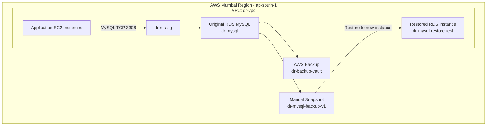

# AWS Database – Amazon RDS MySQL and Recovery

## 1. Overview

This document describes the Amazon Relational Database Service (RDS) infrastructure configured for the AWS Backup, Disaster Recovery and Business Continuity project.

Amazon RDS provides a managed relational database service. This project uses MySQL to demonstrate database deployment, private network access, encryption, automated backups and snapshot-based restoration.

## 2. Objectives

- Deploy a managed MySQL database using Amazon RDS.
- Configure database networking using private subnets.
- Restrict database connectivity through security groups.
- Enable encryption at rest.
- Configure automated backup retention.
- Enable deletion protection.
- Create a manual database snapshot.
- Restore a separate RDS instance from the snapshot.
- Understand database recovery considerations.

## 3. AWS Services Used

| Service | Purpose |
|---|---|
| Amazon RDS | Managed relational database |
| MySQL | Relational database engine |
| Amazon VPC | Isolated network for database resources |
| Private Subnets | Database network placement |
| Security Groups | Restrict database connections |
| AWS Backup | Centralized backup and recovery |
| Amazon EBS | Underlying storage managed by RDS |

## 4. Original RDS Instance Configuration

| Property | Configuration |
|---|---|
| DB identifier | `dr-mysql` |
| Database engine | MySQL |
| Instance class | `db.t3.micro` |
| Allocated storage | 20 GiB |
| Storage type | General Purpose SSD (`gp3`) |
| Availability | Single-AZ |
| Public access | No |
| Encryption at rest | Enabled |
| Backup retention | 1 day |
| Deletion protection | Enabled |
| VPC | `dr-vpc` |
| DB subnet group | Project DB subnet group |
| Security group | `dr-rds-sg` |

The database was deployed in the Mumbai Region (`ap-south-1`).

The configured database subnet group uses the project's private subnets.

## 5. Network and Security Configuration

### 5.1 Private Database Placement

The RDS instance was configured without public access.

Its subnet group uses the private subnets:

- `dr-private-a`
- `dr-private-b`

This places the database within the VPC rather than exposing it directly to the public internet.

### 5.2 RDS Security Group

**Security group:** `dr-rds-sg`

Inbound rule:

| Type | Protocol | Port | Source |
|---|---|---:|---|
| MySQL/Aurora | TCP | 3306 | `dr-ec2-sg` |

Only resources associated with the application security group are permitted by this inbound rule.

### 5.3 Database Access Flow

1. An authorized application EC2 instance initiates a connection.
2. The request travels within the VPC.
3. The RDS security group checks the source security group.
4. MySQL traffic is permitted on TCP port 3306 when the source is `dr-ec2-sg`.
5. The database endpoint handles the connection.

The database does not have public internet access.

## 6. Database Backup Configuration

### 6.1 Automated Backups

Automated backups were configured with a retention period of one day.

Automated backups help preserve database recovery points within the configured retention period.

### 6.2 Manual Snapshot

A manual snapshot was created.

**Snapshot identifier:** `dr-mysql-backup-v1`

Manual snapshots provide a separately retained recovery point that can be used to restore a new RDS instance.

### 6.3 AWS Backup Integration

The project also uses AWS Backup for centralized protection.

The RDS resources were included in the project's AWS Backup resource assignment.

The backup configuration uses:

- Backup plan: `dr-backup-plan`
- Backup rule: `dr-daily-backup`
- Backup vault: `dr-backup-vault`
- Schedule: Hourly, starting at 3:00 PM Asia/Calcutta
- Backup retention: 7 days
- Configured cross-region copy destination: `dr-cross-region-vault` in Singapore

The schedule is hourly as configured in this project.

## 7. RDS Snapshot Restoration

A separate RDS instance was restored from the manual snapshot.

**Restored instance identifier:** `dr-mysql-restore-test`

The restored instance was configured in the project VPC without public access.

### Restoration Procedure

1. Open the Amazon RDS console.
2. Navigate to Snapshots.
3. Select `dr-mysql-backup-v1`.
4. Choose the restore action.
5. Enter the new DB identifier `dr-mysql-restore-test`.
6. Configure the VPC and database networking settings.
7. Keep public access disabled.
8. Configure the appropriate security group.
9. Start the restoration.
10. Wait for the restored DB instance to become Available.

### Restoration Result

The restored RDS instance reached the Available state.

This verified that the snapshot could be used to create a separate database instance.

**Important validation limitation:** The original database did not contain an application database or application records. Therefore, this exercise validated infrastructure-level snapshot restoration, not the recovery of application records or database transactions.

The original RDS instance was not modified as part of this documentation step.

## 8. Database Recovery Architecture

*The diagram shows the database security boundary, manual snapshot restoration and AWS Backup integration. The restored instance is a separate resource.*

## 9. Database Recovery Considerations

A database recovery process should consider more than whether an RDS instance reaches the Available state.

Important checks include:

- Correct database engine and compatible version.
- Correct VPC and subnet group.
- Correct security-group rules.
- Public accessibility settings.
- Database credentials and connection configuration.
- Application connectivity.
- Database schema and table availability.
- Record-level data integrity.
- Recovery Point Objective (RPO).
- Recovery Time Objective (RTO).

The project's snapshot restoration exercise validated instance restoration. Application-level and record-level recovery remain outside the completed test scope because no application database or records were created.

## 10. Limitations

- The original RDS instance is Single-AZ.
- No application database or application records were created.
- The restore test verified that a separate RDS instance could reach Available status.
- Application-level database connectivity and record integrity were not validated.
- The project does not demonstrate automated database failover.

## 11. Implementation Summary

The following database activities were completed:

- Configured the RDS MySQL instance `dr-mysql`.
- Selected the `db.t3.micro` instance class.
- Allocated 20 GiB of `gp3` storage.
- Configured private database access.
- Enabled encryption at rest.
- Configured one-day automated backup retention.
- Enabled deletion protection.
- Restricted MySQL access through `dr-rds-sg`.
- Created manual snapshot `dr-mysql-backup-v1`.
- Restored a separate instance named `dr-mysql-restore-test`.
- Verified that the restored instance reached Available status.

## 12. Related Documentation

- [Project Overview](../README.md)
- [Architecture Documentation](../architecture/aws-architecture.md)
- [Networking Documentation](../networking/README.md)
- [Compute Documentation](../compute/README.md)
- [Storage Documentation](../storage/README.md)
- [Backup Documentation](../backup/README.md)
- [Disaster Recovery Documentation](../disaster-recovery/README.md)

---

**Project:** AWS Backup, Disaster Recovery and Business Continuity  
**Document:** Amazon RDS MySQL and Database Recovery  
**Region:** `ap-south-1`