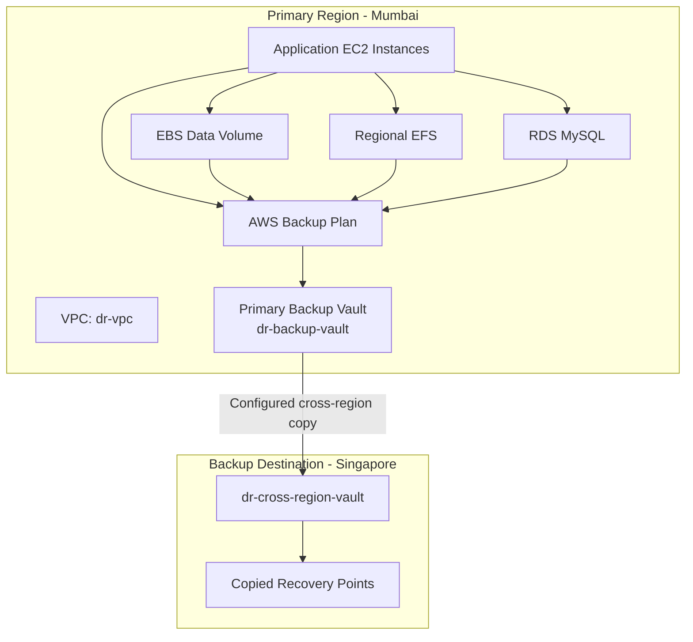

# Disaster Recovery – AWS Recovery Strategy and Validation

## 1. Overview

This document describes the disaster recovery strategy implemented for the AWS Backup, Disaster Recovery and Business Continuity project.

The project demonstrates recovery using Amazon EC2 AMIs, EBS recovery points, Amazon EFS, Amazon RDS snapshots and AWS Backup cross-region copying.

The primary infrastructure is deployed in the Mumbai Region (`ap-south-1`). A backup vault in Singapore (`ap-southeast-1`) provides a separate regional destination for supported backup copies.

## 2. Disaster Recovery Objectives

- Understand common infrastructure failure scenarios.
- Recover an EC2 application server using an AMI.
- Restore EBS data from a backup recovery point.
- Validate shared file access using EFS.
- Restore an RDS instance from a manual snapshot.
- Verify a cross-region backup recovery point.
- Understand backup retention and recovery limitations.

## 3. Disaster Recovery Concepts

| Concept | Meaning |
|---|---|
| Disaster Recovery (DR) | Restoring IT services after a disruption |
| Recovery Point Objective (RPO) | Maximum acceptable data-loss interval |
| Recovery Time Objective (RTO) | Target time for restoring a service |
| Backup | A protected copy of data or resources |
| Recovery Point | A point-in-time backup that can be used for restoration |
| Failover | Switching operations to an alternate system or location |
| Failback | Returning operations to the original environment |

RPO and RTO are important planning targets. This project demonstrates recovery mechanisms but does not establish measured production RPO or RTO guarantees.

## 4. Disaster Recovery Architecture

The project uses a primary AWS environment in Mumbai and a cross-region backup destination in Singapore.



The diagram represents the configured backup architecture. It does not imply that every resource has been restored or failed over in Singapore.

## 5. EC2 Disaster Recovery

### 5.1 Recovery Method

Amazon Machine Images (AMIs) can be used to launch replacement EC2 instances.

The project created:

`dr-app-server-ami-v1`

A replacement instance was launched:

`dr-recovered-server`

### 5.2 Recovery Procedure

1. Identify the failed application instance.
2. Select the available AMI.
3. Launch a replacement EC2 instance.
4. Select the appropriate VPC and subnet.
5. Configure the security group.
6. Configure the required key pair.
7. Wait for the instance to become available.
8. Verify application startup.
9. Access the application using the recovered instance's public address.

### 5.3 Failure Simulation

The project performed an EC2 failure simulation:

1. Confirmed the original application server was running.
2. Created an AMI.
3. Launched the recovered EC2 instance.
4. Verified the application page on the recovered instance.
5. Stopped `dr-app-server-a`.
6. Confirmed that the recovered server continued serving the application.
7. Restarted the original instance.

**Result:** The AMI-based replacement server successfully served the application while the original instance was stopped.

## 6. EBS Disaster Recovery

### 6.1 Recovery Method

Amazon EBS snapshots and AWS Backup recovery points can be used to restore block-storage volumes.

The project used an AWS Backup recovery point to create a new EBS volume.

### 6.2 Recovery Procedure

1. Identify the required EBS recovery point.
2. Start the restore operation.
3. Select the destination availability zone and volume configuration.
4. Wait for the restored volume to become available.
5. Attach the volume to a compatible recovery EC2 instance.
6. Identify the new block device.
7. Mount the filesystem.
8. Inspect the recovered data.

Example commands used during the project:

```bash
sudo mkdir -p /mnt/restored-data
sudo mount -o nouuid /dev/nvme2n1 /mnt/restored-data
sudo ls -la /mnt/restored-data
```

### 6.3 Recovery Validation

The restored EBS volume was attached to a recovery instance and mounted successfully.

The original data contents were not fully verified in the recorded test, so content-level recovery should not be considered confirmed.

## 7. EFS Disaster Recovery and Shared Storage

### 7.1 Recovery Approach

Amazon EFS provides shared file access to multiple EC2 instances.

The project used a Regional EFS file system:

`dr-efs`

Mount targets were configured in two Availability Zones.

### 7.2 Validation Procedure

1. Mount EFS on the first EC2 instance.
2. Create a test file.
3. Mount the same file system on a second EC2 instance.
4. Read the file from the second instance.
5. Mount EFS on the recovered EC2 instance.
6. Verify that the shared file is accessible.

### 7.3 Validation Result

The shared file was successfully accessed from multiple EC2 instances, including the recovered instance.

This validated shared storage access during the EC2 recovery exercise.

It did not constitute a full EFS backup-and-restore test.

## 8. RDS Disaster Recovery

### 8.1 Recovery Method

Amazon RDS supports restoration from automated backups and manual snapshots.

The project created a manual snapshot:

`dr-mysql-backup-v1`

A separate restored instance was created:

`dr-mysql-restore-test`

### 8.2 Recovery Procedure

1. Open the Amazon RDS console.
2. Navigate to Snapshots.
3. Select `dr-mysql-backup-v1`.
4. Choose Restore snapshot.
5. Enter `dr-mysql-restore-test` as the new identifier.
6. Configure the VPC and subnet group.
7. Keep public access disabled.
8. Select the appropriate security group.
9. Start restoration.
10. Wait for the new instance to reach Available status.

### 8.3 Validation Result

The restored RDS instance reached Available status.

The original database did not contain an application database or application records. Therefore, the test validated infrastructure-level snapshot restoration, not application-data recovery.

The original RDS instance was not modified for this documentation exercise.

## 9. Cross-Region Disaster Recovery

### 9.1 Purpose

Cross-region backup copying provides an additional recovery location outside the primary AWS Region.

The project configured:

| Property | Configuration |
|---|---|
| Primary Region | Mumbai (`ap-south-1`) |
| Primary vault | `dr-backup-vault` |
| Destination Region | Singapore (`ap-southeast-1`) |
| Destination vault | `dr-cross-region-vault` |
| Copy retention | 7 days |

### 9.2 Cross-Region Recovery Workflow

1. Create a backup recovery point in the primary Region.
2. Execute the configured copy action.
3. Transfer the supported recovery point to the destination Region.
4. Open the AWS Backup console in Singapore.
5. Inspect the destination backup vault.
6. Verify the copied recovery point status.

### 9.3 Validation Result

A cross-region EBS recovery point was verified as Available in Singapore.

This confirms the tested EBS copy workflow. It does not prove that all protected resource types were independently restored in Singapore.

## 10. Recovery Validation Summary

| Resource | Recovery method | Recorded validation |
|---|---|---|
| EC2 | AMI-based replacement | Recovered server served application during original instance stop |
| EBS | AWS Backup recovery point | Restored volume attached and mounted; content verification pending |
| EFS | Shared file access | File read successfully across EC2 instances |
| RDS | Manual snapshot | Separate restored instance reached Available |
| Cross-region EBS | Backup copy | Destination recovery point reached Available |

## 11. Recovery Limitations

The project is a learning and demonstration environment, not a fully automated production disaster recovery platform.

Current limitations include:

- No automated application failover.
- No load balancer configured.
- No Auto Scaling Group configured.
- No measured production RPO or RTO.
- RDS uses Single-AZ deployment.
- No full application database or record recovery test.
- EBS restored volume content verification remains pending.
- Cross-region EBS recovery point availability was verified, but full application recovery in Singapore was not performed.
- EFS shared access was tested, but a full EFS backup restoration was not demonstrated.

## 12. Future Improvements

Possible future enhancements include:

- Automating EC2 recovery using infrastructure-as-code.
- Adding health checks and automated failover.
- Introducing an Application Load Balancer.
- Using Multi-AZ database deployment where appropriate.
- Performing full application and database recovery tests.
- Testing complete recovery in the secondary Region.
- Measuring actual recovery time and data-loss intervals.
- Documenting a formal disaster recovery runbook.

These are future improvements, not completed project features.

## 13. Conclusion

This project demonstrates several AWS disaster recovery techniques:

- EC2 replacement using AMIs.
- EBS restoration from backup recovery points.
- Shared EFS access during instance recovery.
- RDS restoration from manual snapshots.
- Cross-region backup copying.

Together, these exercises provide practical experience with AWS backup, restoration and business continuity concepts.

---

**Project:** AWS Backup, Disaster Recovery and Business Continuity  
**Document:** Disaster Recovery Strategy and Validation  
**Primary Region:** `ap-south-1`  
**Backup Destination:** `ap-southeast-1`