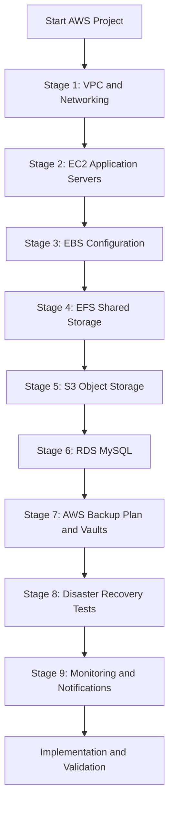

# AWS Project Implementation Guide

## 1. Overview

This document describes the implementation sequence followed while building the AWS Backup, Disaster Recovery and Business Continuity project.

The infrastructure was created in the Mumbai AWS Region (`ap-south-1`), with a cross-region backup destination in Singapore (`ap-southeast-1`).

The implementation covers networking, compute, storage, database, centralized backup, disaster recovery and monitoring.

## 2. Implementation Objectives

- Build an isolated AWS network.
- Deploy application EC2 instances.
- Configure persistent and shared storage.
- Deploy a private RDS MySQL instance.
- Configure centralized AWS Backup.
- Configure cross-region backup copying.
- Test resource recovery.
- Configure backup event notifications.

## 3. AWS Environment

| Configuration | Value |
|---|---|
| Primary Region | Mumbai (`ap-south-1`) |
| Backup destination Region | Singapore (`ap-southeast-1`) |
| Project prefix | `dr-` |
| VPC | `dr-vpc` |
| VPC CIDR | `10.30.0.0/16` |
| Operating system | Amazon Linux 2023 |
| Database engine | MySQL |

## 4. Implementation Sequence

The project was implemented in the following stages.

### Stage 1 – Networking

Created the VPC and network components.

Resources:

- VPC `dr-vpc`
- Public subnets `dr-public-a` and `dr-public-b`
- Private subnets `dr-private-a` and `dr-private-b`
- Internet Gateway `dr-igw`
- Public route table `dr-public-rt`
- Private route table `dr-private-rt`
- EC2 security group `dr-ec2-sg`
- EFS security group `dr-efs-sg`
- RDS security group `dr-rds-sg`

The public route table uses the Internet Gateway for its default IPv4 route. The private route table contains the local VPC route and has no NAT Gateway default route.

### Stage 2 – EC2 Compute

Deployed two application instances:

- `dr-app-server-a`
- `dr-app-server-b`

Both instances use Amazon Linux 2023 and the `t3.micro` instance type.

Apache was installed and configured to serve a basic project web page.

### Stage 3 – EBS Storage

Configured the application data volume:

- Volume name: `dr-app-data`
- Type: `gp3`
- Size: 5 GiB
- Encryption: Enabled
- File system: XFS
- Mount point: `/data`

Created a manual snapshot and configured an EBS Lifecycle Manager policy with daily scheduling and seven-snapshot retention.

### Stage 4 – EFS Shared Storage

Created Regional EFS file system `dr-efs`.

Configured mount targets in the two private subnets and restricted NFS access through `dr-efs-sg`.

Mounted the file system on multiple EC2 instances and tested shared-file access.

### Stage 5 – S3 Object Storage

Created S3 bucket `yash-dr-backup-2026`.

Configured:

- Block Public Access
- ACLs disabled
- Versioning enabled
- SSE-S3 default encryption
- Lifecycle rule `dr-s3-lifecycle`

Uploaded an object multiple times, inspected its versions and downloaded an older version.

### Stage 6 – RDS Database

Deployed MySQL instance `dr-mysql`.

Configured:

- `db.t3.micro` instance class
- 20 GiB `gp3` storage
- Private network access
- Encryption at rest
- One-day automated backup retention
- Deletion protection

Created manual snapshot `dr-mysql-backup-v1` and restored a separate instance named `dr-mysql-restore-test`.

No application database or records were created in the original RDS instance.

### Stage 7 – Centralized AWS Backup

Created the primary backup vault:

`dr-backup-vault`

Created the destination vault in Singapore:

`dr-cross-region-vault`

Created backup plan `dr-backup-plan` and rule `dr-daily-backup`.

The rule uses an hourly schedule starting at 3:00 PM Asia/Calcutta, with a one-hour start window, two-hour completion window and seven-day retention.

Configured the cross-region copy action to Singapore with seven-day copy retention.

Created the main resource assignment and a separate EFS assignment.

### Stage 8 – Disaster Recovery

Performed recovery exercises using:

- EC2 AMI-based replacement.
- EBS recovery-point restoration.
- EFS shared-file access.
- RDS manual snapshot restoration.
- Cross-region EBS recovery-point verification.

### Stage 9 – Monitoring and Notifications

Created EventBridge rule `dr-backup-notification-rule`.

Configured it to detect:

- Backup Job State Change
- Copy Job State Change
- Restore Job State Change

Created SNS topic `dr-backup-alerts`, confirmed the email subscription and verified notification delivery.

Inspected the `AWS/Backup` CloudWatch metrics namespace.

## 5. Implementation Flow Diagram

## 6. Resource Naming Convention

The project uses the `dr-` prefix for most AWS resource names.

Examples:

| Resource type | Name |
|---|---|
| VPC | `dr-vpc` |
| Internet Gateway | `dr-igw` |
| Public route table | `dr-public-rt` |
| Private route table | `dr-private-rt` |
| Application EC2 | `dr-app-server-a` |
| EBS volume | `dr-app-data` |
| EFS | `dr-efs` |
| RDS | `dr-mysql` |
| Backup plan | `dr-backup-plan` |
| Primary vault | `dr-backup-vault` |
| DR vault | `dr-cross-region-vault` |
| EventBridge rule | `dr-backup-notification-rule` |
| SNS topic | `dr-backup-alerts` |

The S3 bucket uses the globally unique name `yash-dr-backup-2026`.

## 7. Implementation Validation

The following activities were used to validate the implementation:

| Area | Validation |
|---|---|
| Networking | Application access through public EC2 instances |
| EC2 | Apache application page served successfully |
| AMI | Recovered instance served application during failure simulation |
| EBS | Restored volume attached and mounted |
| EFS | Shared file read across multiple EC2 instances |
| S3 | Older object version downloaded |
| RDS | Separate snapshot-restored instance reached Available |
| AWS Backup | Completed backup jobs observed |
| Cross-region backup | EBS recovery point Available in Singapore |
| EventBridge and SNS | Backup notification email received |
| CloudWatch | AWS/Backup metrics namespace inspected |

## 8. Important Implementation Decisions

### No NAT Gateway

The project was built without a NAT Gateway to avoid its additional running and data-processing costs.

Private subnet resources therefore do not have general outbound IPv4 internet access through NAT.

### Single-AZ RDS

The RDS instance uses Single-AZ deployment. This project demonstrates backup and restoration rather than automatic Multi-AZ database failover.

### Manual Recovery Validation

Recovery exercises were performed manually through the AWS Console and EC2 operations. The project does not implement fully automated regional failover.

### Separate Storage Recovery

EBS, EFS and S3 use different storage models and recovery mechanisms. Their protection and validation procedures are documented separately.

## 9. Implementation Limitations

- No NAT Gateway.
- No Application Load Balancer.
- No Auto Scaling Group.
- No Multi-AZ RDS deployment.
- No automated application failover.
- No dedicated CloudWatch dashboard or alarm.
- EBS restored-volume content verification remains pending.
- Full application-data recovery was not demonstrated for RDS.
- Full application recovery in Singapore was not performed.

## 10. Related Documentation

- [Project Overview](../README.md)
- [Architecture Documentation](../architecture/aws-architecture.md)
- [Networking Documentation](../networking/README.md)
- [Compute Documentation](../compute/README.md)
- [Storage Documentation](../storage/README.md)
- [Database Documentation](../database/README.md)
- [Backup Documentation](../backup/README.md)
- [Disaster Recovery Documentation](../disaster-recovery/README.md)
- [Monitoring Documentation](../monitoring/README.md)

---

**Project:** AWS Backup, Disaster Recovery and Business Continuity  
**Document:** Implementation Guide  
**Primary Region:** `ap-south-1`  
**Backup Destination:** `ap-southeast-1`