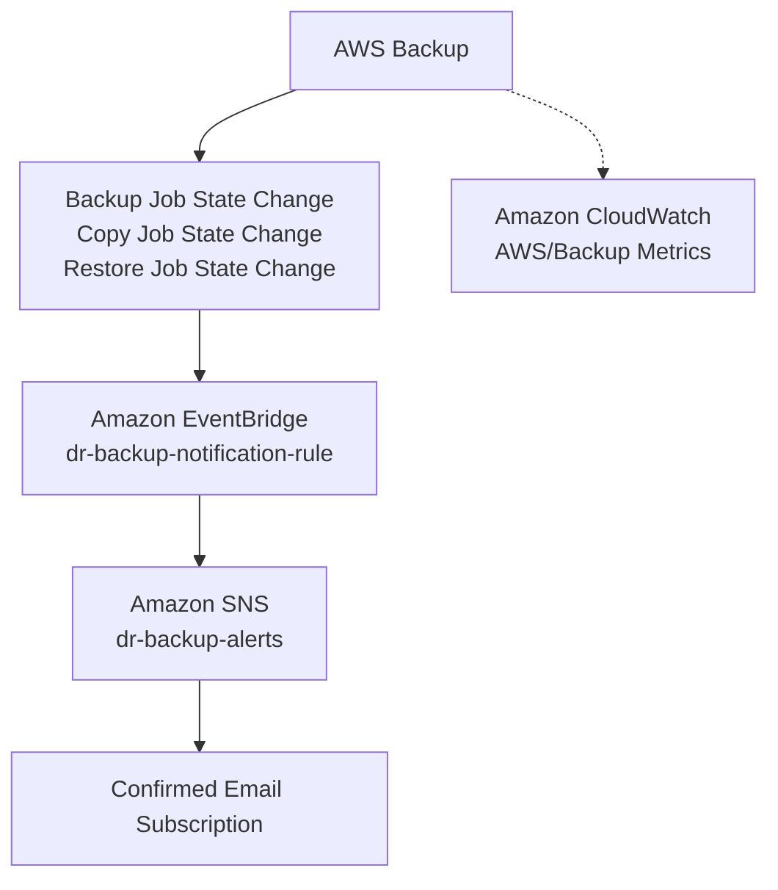

# AWS Monitoring – CloudWatch, EventBridge and SNS Notifications

## 1. Overview

This document describes the monitoring and notification configuration implemented for the AWS Backup, Disaster Recovery and Business Continuity project.

Monitoring helps administrators observe backup operations, identify job failures and receive notifications about important backup-related events.

The project uses Amazon CloudWatch, AWS Backup, Amazon EventBridge and Amazon SNS to support backup monitoring and email notifications.

## 2. Objectives

- Monitor AWS Backup job activity.
- Inspect backup-related CloudWatch metrics.
- Detect backup, copy and restore job state changes.
- Route matching events through Amazon EventBridge.
- Send email notifications using Amazon SNS.
- Validate notification delivery.

## 3. AWS Services Used

| Service | Purpose |
|---|---|
| Amazon CloudWatch | Provides monitoring metrics |
| AWS Backup | Provides backup job status and recovery point information |
| Amazon EventBridge | Detects and routes backup-related events |
| Amazon SNS | Delivers email notifications |

## 4. AWS Backup Job Monitoring

AWS Backup provides job information for backup, copy and restore operations.

The AWS Backup console was used to inspect job history and confirm completion status.

### 4.1 Monitored Resources

The project had completed backup jobs for:

- `dr-app-server-a`
- `dr-app-server-b`
- `dr-recovered-server`
- `dr-app-data`
- `dr-efs`
- `dr-mysql`
- `dr-mysql-restore-test`

### 4.2 Backup Job Verification

The following checks were performed:

1. Open the AWS Backup console.
2. Navigate to Backup jobs.
3. Inspect the job history.
4. Review the protected resource.
5. Check the job status.
6. Inspect recovery points in the backup vault.

The listed backup jobs were observed with Completed status.

## 5. Amazon CloudWatch

### 5.1 Overview

Amazon CloudWatch is an AWS monitoring service that provides metrics and operational visibility for supported AWS resources and services.

In this project, CloudWatch was used to inspect the AWS Backup metrics namespace.

### 5.2 Metrics Namespace

The following namespace was inspected:

`AWS/Backup`

This namespace provides backup-related metrics published by AWS Backup.

The namespace inspection was used to understand the availability of backup monitoring metrics.

### 5.3 Monitoring Considerations

CloudWatch monitoring can help administrators:

- Observe backup-related metrics.
- Identify unusual changes in monitored activity.
- Build dashboards for operational visibility.
- Configure alarms for selected metric conditions.
- Integrate monitoring with notification workflows.

**Implementation scope:** The project inspected the `AWS/Backup` metrics namespace. A dedicated CloudWatch dashboard and CloudWatch alarm were not configured.

## 6. Amazon EventBridge

### 6.1 Overview

Amazon EventBridge is a serverless event-routing service.

It can detect matching events from AWS services and forward them to configured targets.

The project uses EventBridge to detect AWS Backup job state changes.

### 6.2 EventBridge Rule Configuration

| Property | Configuration |
|---|---|
| Rule name | `dr-backup-notification-rule` |
| Event bus | Default |
| Event source | `aws.backup` |
| Target | Amazon SNS |
| Target topic | `dr-backup-alerts` |
| Status | Enabled |

### 6.3 Event Pattern

The rule listens for the following event types:

```json
{
  "source": ["aws.backup"],
  "detail-type": [
    "Backup Job State Change",
    "Copy Job State Change",
    "Restore Job State Change"
  ]
}
```

### 6.4 Event Flow

When AWS Backup publishes a matching event:

1. EventBridge receives the event.
2. The event pattern is evaluated.
3. Matching events are routed to the configured SNS topic.
4. SNS processes the notification.
5. Confirmed email subscribers receive the notification.

## 7. Amazon SNS

### 7.1 Overview

Amazon Simple Notification Service (SNS) is a managed messaging service that can deliver notifications to supported endpoints.

In this project, SNS was configured to deliver backup-related notifications through email.

### 7.2 SNS Topic Configuration

| Property | Configuration |
|---|---|
| Topic name | `dr-backup-alerts` |
| Region | `ap-south-1` |
| Protocol | Email |
| Publisher | EventBridge rule |
| Purpose | Backup event notifications |

### 7.3 Email Subscription

An email subscription was created for the SNS topic.

The subscription confirmation process was completed.

After confirmation, the email endpoint became eligible to receive notifications from the topic.

### 7.4 Notification Validation

A backup-related event was used to validate the notification workflow.

The notification email was received successfully.

**Result:** Email notification delivery was successfully validated.

## 8. Monitoring Architecture Diagram



*The diagram shows the configured event notification flow and the separate CloudWatch metrics inspection.*

## 9. Implementation Summary

The following monitoring activities were completed:

- Inspected AWS Backup job history.
- Verified completed backup jobs.
- Inspected the `AWS/Backup` CloudWatch metrics namespace.
- Created EventBridge rule `dr-backup-notification-rule`.
- Configured backup, copy and restore job state-change event types.
- Configured SNS topic `dr-backup-alerts`.
- Added an email subscription.
- Confirmed the email subscription.
- Verified that a notification email was received.

## 10. Security Considerations

- Restrict access to CloudWatch monitoring resources.
- Limit permissions to modify EventBridge rules.
- Protect SNS topic access through appropriate IAM permissions and topic policies.
- Use only intended email subscribers.
- Avoid including sensitive information in notification messages.
- Review notification delivery and subscription status periodically.

## 11. Limitations

- A dedicated CloudWatch dashboard was not created.
- A dedicated CloudWatch alarm was not configured.
- Monitoring is focused on backup-related events and metrics.
- Email delivery was validated, but a complete operational incident-response workflow was not implemented.

## 12. Future Improvements

Possible improvements include:

- Create a CloudWatch dashboard for backup operations.
- Configure alarms for selected backup failure metrics.
- Add additional notification endpoints.
- Integrate notifications with an incident-management platform.
- Maintain a backup job success and failure report.
- Define operational response procedures for failed backup jobs.

These are proposed improvements, not completed project features.

## 13. Related Documentation

- [Project Overview](../README.md)
- [Architecture Documentation](../architecture/aws-architecture.md)
- [Backup Documentation](../backup/README.md)
- [Disaster Recovery Documentation](../disaster-recovery/README.md)
- [Database Documentation](../database/README.md)
- [Storage Documentation](../storage/README.md)

---

**Project:** AWS Backup, Disaster Recovery and Business Continuity  
**Document:** Monitoring and Backup Notifications  
**Region:** `ap-south-1`