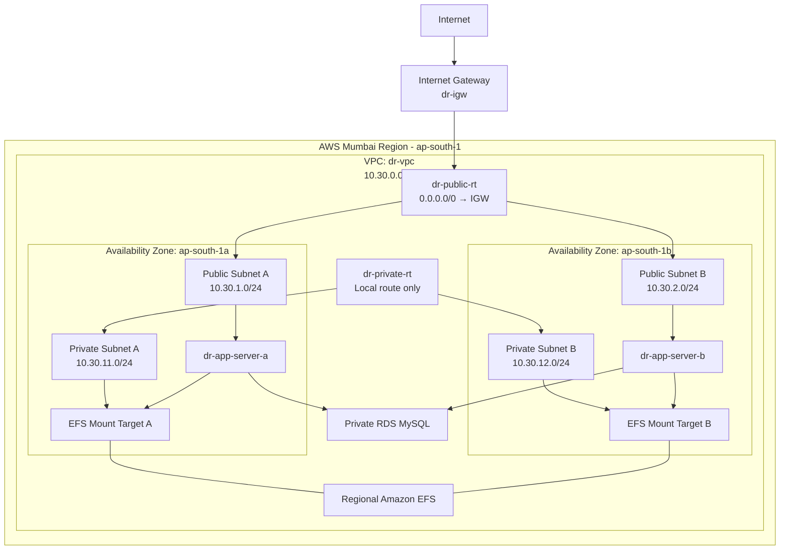

# AWS Networking – VPC, Subnets, Routing and Security Groups

## 1. Overview

This document describes the networking architecture implemented for the AWS Backup, Disaster Recovery and Business Continuity project.

The infrastructure uses an Amazon VPC in the Mumbai Region (`ap-south-1`). Public and private subnets are distributed across two Availability Zones to organize application and database resources.

## 2. Purpose

The networking design provides:

- An isolated network for project resources.
- Public connectivity for application EC2 instances.
- Private network placement for database resources.
- Separate public and private routing configurations.
- Security-group-based traffic restrictions.
- Network connectivity for shared EFS storage.

## 3. Technologies and AWS Services

| Service | Purpose |
|---|---|
| Amazon VPC | Isolated virtual network |
| Amazon Subnets | Divide the VPC into network segments |
| Internet Gateway | Internet connectivity for public subnets |
| Route Tables | Control network traffic routing |
| Security Groups | Control inbound and outbound instance traffic |
| Availability Zones | Distribute network resources across separate zones |

## 4. VPC Configuration

| Property | Configuration |
|---|---|
| VPC name | `dr-vpc` |
| VPC CIDR | `10.30.0.0/16` |
| AWS Region | `ap-south-1` |
| Internet Gateway | `dr-igw` |
| DNS support | Use the configured VPC DNS settings |

The VPC provides the network boundary for the project's EC2, EFS and RDS resources.

## 5. Subnet Configuration

Four subnets were created across two Availability Zones.

| Subnet name | CIDR block | Availability Zone | Type |
|---|---|---|---|
| `dr-public-a` | `10.30.1.0/24` | `ap-south-1a` | Public |
| `dr-public-b` | `10.30.2.0/24` | `ap-south-1b` | Public |
| `dr-private-a` | `10.30.11.0/24` | `ap-south-1a` | Private |
| `dr-private-b` | `10.30.12.0/24` | `ap-south-1b` | Private |

### Public Subnets

Public subnets host application EC2 instances.

Configuration:

- Automatic public IPv4 assignment enabled.
- Associated with `dr-public-rt`.
- Default route points to the Internet Gateway.

### Private Subnets

Private subnets provide network placement for database and EFS-related infrastructure.

Configuration:

- Automatic public IPv4 assignment disabled.
- Associated with `dr-private-rt`.
- No NAT Gateway default route configured.

## 6. Internet Gateway

**Resource name:** `dr-igw`

The Internet Gateway is attached to `dr-vpc`.

It provides internet connectivity for resources in public subnets when their route tables and security groups permit the required traffic.

The Internet Gateway is not directly associated with private subnet routing.

## 7. Route Table Configuration

Two custom route tables were configured.

### 7.1 Public Route Table

**Name:** `dr-public-rt`

Associated subnets:

- `dr-public-a`
- `dr-public-b`

Important routes:

| Destination | Target |
|---|---|
| `10.30.0.0/16` | Local |
| `0.0.0.0/0` | `dr-igw` |

The default route allows eligible public subnet resources to communicate with external IPv4 destinations through the Internet Gateway.

### 7.2 Private Route Table

**Name:** `dr-private-rt`

Associated subnets:

- `dr-private-a`
- `dr-private-b`

Important route:

| Destination | Target |
|---|---|
| `10.30.0.0/16` | Local |

There is no default internet route through a NAT Gateway.

### NAT Gateway Design Decision

A NAT Gateway was not configured in this project.

The private subnet resources therefore do not have general outbound IPv4 internet access through a NAT Gateway.

This design avoids NAT Gateway hourly and data-processing charges. It also means that private resources requiring external package repositories or internet services need an alternative access method.

## 8. Networking Architecture Diagram

*The diagram represents the logical network layout. EFS mount targets provide access to the Regional EFS file system from their respective Availability Zones.*

## 9. Security Group Configuration

Security groups control traffic to the project resources.

### 9.1 Application EC2 Security Group

**Name:** `dr-ec2-sg`

Purpose: Protect application EC2 instances.

Inbound rules:

| Type | Protocol | Port | Source |
|---|---|---|---|
| SSH | TCP | 22 | Administrator's My IP |
| HTTP | TCP | 80 | Administrator's My IP |

Outbound traffic uses the configured default security-group egress rules.

### 9.2 EFS Security Group

**Name:** `dr-efs-sg`

Purpose: Permit application instances to access EFS.

Inbound rule:

| Type | Protocol | Port | Source |
|---|---|---|---|
| NFS | TCP | 2049 | `dr-ec2-sg` |

This permits NFS access from EC2 instances associated with the application security group.

### 9.3 RDS Security Group

**Name:** `dr-rds-sg`

Purpose: Restrict database connectivity.

Inbound rule:

| Type | Protocol | Port | Source |
|---|---|---|---|
| MySQL/Aurora | TCP | 3306 | `dr-ec2-sg` |

The database does not allow direct public internet access.

## 10. Traffic Flow

### Application Access

1. A user accesses the application using the EC2 public IPv4 address.
2. The traffic reaches the VPC through the Internet Gateway.
3. The public route table directs eligible internet traffic to the Internet Gateway.
4. The application security group evaluates inbound HTTP traffic.
5. The Apache web server responds to the request.

HTTP access is restricted by the configured security-group source rule.

### Database Access

1. An application EC2 instance initiates a database connection.
2. The connection travels within the VPC.
3. The RDS security group checks the source security group.
4. MySQL traffic is permitted on TCP port 3306 when the source is `dr-ec2-sg`.

### Shared File Access

1. An application EC2 instance initiates an NFS connection.
2. The connection uses TCP port 2049.
3. The EFS security group checks the source.
4. NFS traffic is permitted from `dr-ec2-sg`.
5. The instance accesses the shared EFS file system through its mount target.

## 11. Implementation Summary

The following networking components were implemented:

- Created VPC `dr-vpc`.
- Created four subnets across two Availability Zones.
- Attached Internet Gateway `dr-igw`.
- Created public route table `dr-public-rt`.
- Created private route table `dr-private-rt`.
- Associated the respective subnets with their route tables.
- Enabled automatic public IPv4 assignment on public subnets.
- Disabled automatic public IPv4 assignment on private subnets.
- Created EC2, EFS and RDS security groups.
- Configured restricted SSH, HTTP, NFS and MySQL access.
- Did not configure a NAT Gateway.

## 12. Verification

The networking implementation was used to support the following verified activities:

- Application EC2 instances were deployed in public subnets.
- The Apache application page was accessed through a public IP.
- EC2 instances communicated with the shared EFS file system.
- EFS shared-file access was tested across two EC2 instances.
- RDS was deployed without public access.
- Database access was configured through the application security group.

These checks demonstrate that the networking configuration supported the project's application, storage and database requirements.

## 13. Security Considerations

- SSH access should remain restricted to the administrator's IP.
- HTTP access should only be opened to intended sources.
- RDS should remain private.
- MySQL access should only be permitted from authorized application resources.
- NFS access should remain restricted to the application security group.
- Private subnets should not receive unnecessary public routes.
- Security-group rules should be reviewed periodically.

## 14. Related Documentation

- [Project Overview](../README.md)
- [Architecture Documentation](../architecture/aws-architecture.md)
- [Compute Documentation](../compute/README.md)
- [Storage Documentation](../storage/README.md)
- [Database Documentation](../database/README.md)

---

**Project:** AWS Backup, Disaster Recovery and Business Continuity  
**Document:** Networking Architecture and Configuration  
**Region:** `ap-south-1`