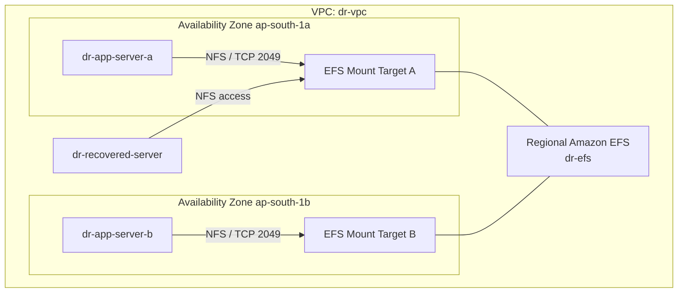
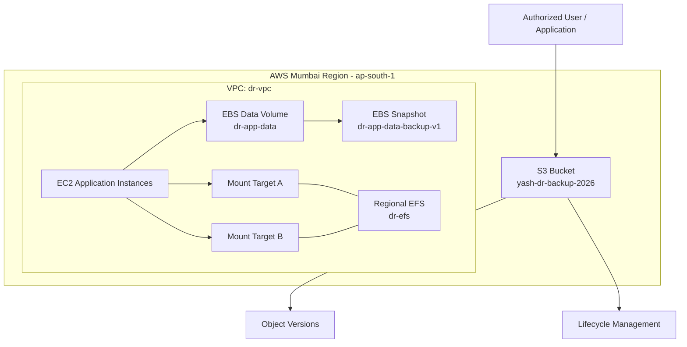

# AWS Storage – EBS, EFS and S3

## 1. Overview

This document describes the storage services implemented for the AWS Backup, Disaster Recovery and Business Continuity project.

Three Amazon Web Services storage solutions were configured to demonstrate different storage models and recovery capabilities:

- Amazon Elastic Block Store (EBS) for EC2 block storage.
- Amazon Elastic File System (EFS) for shared file storage.
- Amazon Simple Storage Service (S3) for object storage, versioning and lifecycle management.

## 2. Objectives

- Configure persistent block storage for EC2.
- Create EBS snapshots and test volume recovery.
- Configure a shared EFS file system.
- Access shared files from multiple EC2 instances.
- Configure an S3 bucket with public access blocked.
- Enable S3 versioning.
- Configure S3 lifecycle management.
- Understand how different storage services support disaster recovery.

## 3. AWS Storage Services

| Service | Storage model | Project use |
|---|---|---|
| Amazon EBS | Block storage | EC2 data volume and snapshot recovery |
| Amazon EFS | Shared file storage | Shared files across EC2 instances |
| Amazon S3 | Object storage | Backup files, versioning and lifecycle management |

## 4. Amazon EBS – Elastic Block Store

### 4.1 Overview

Amazon EBS provides persistent block-level storage volumes for EC2 instances.

An EBS volume can be attached to an EC2 instance and formatted with a supported file system. EBS snapshots provide point-in-time backups that can be used to create replacement volumes.

### 4.2 EBS Volume Configuration

| Property | Configuration |
|---|---|
| Volume name | `dr-app-data` |
| Volume type | General Purpose SSD (`gp3`) |
| Size | 5 GiB |
| Encryption | Enabled |
| Attached instance | `dr-app-server-a` |
| Device requested | `/dev/sdf` |
| Linux device observed | `/dev/nvme1n1` |
| Mount point | `/data` |
| File system | XFS |

The volume was formatted with XFS and mounted at `/data`.

The filesystem UUID was added to `/etc/fstab` so that the volume could be mounted automatically after a reboot.

### 4.3 EBS Snapshot

A manual EBS snapshot was created.

**Snapshot name:** `dr-app-data-backup-v1`

The snapshot provides a recovery point for the EBS data volume.

### 4.4 EBS Lifecycle Manager

An EBS Lifecycle Manager policy was configured.

| Property | Configuration |
|---|---|
| Policy target | Volume tagged `Name=dr-app-data` |
| Schedule | Daily |
| Retention | 7 snapshots |

The policy automates snapshot creation and retention for matching volumes.

### 4.5 EBS Recovery Test

An EBS recovery exercise was performed using an AWS Backup recovery point.

The restored volume appeared as an additional NVMe device on the recovery EC2 instance.

The following commands were used during the recovery process:

```bash
sudo mkdir -p /mnt/restored-data

sudo mount -o nouuid /dev/nvme2n1 /mnt/restored-data

sudo ls -la /mnt/restored-data
```

The `nouuid` mount option was used because the restored XFS volume had the same filesystem UUID as the original volume.

The restored volume was mounted successfully. Verification of the original application data contents remains a separate validation item.

### 4.6 EBS Recovery Workflow

1. Create an EBS volume.
2. Attach it to an EC2 instance.
3. Format and mount the volume.
4. Create an EBS snapshot.
5. Configure automated snapshots using Lifecycle Manager.
6. Create an AWS Backup recovery point.
7. Restore the recovery point to a new EBS volume.
8. Attach the restored volume to a recovery instance.
9. Mount and inspect the restored filesystem.

## 5. Amazon EFS – Elastic File System

### 5.1 Overview

Amazon EFS is a managed network file system that allows multiple EC2 instances to access shared files.

Unlike a typical EBS volume, which is attached to an individual EC2 instance, EFS can be mounted by multiple instances at the same time.

### 5.2 EFS Configuration

| Property | Configuration |
|---|---|
| File system name | `dr-efs` |
| File system ID | `fs-067b8f1d7cd5754be` |
| Storage class | Regional |
| Throughput mode | Elastic |
| Encryption at rest | Enabled |
| Mount targets | Two |
| Network | `dr-vpc` |
| Mount target subnets | `dr-private-a`, `dr-private-b` |

Mount targets were created in two Availability Zones to provide network access to the Regional file system from both zones.

### 5.3 Security Configuration

The EFS mount targets use:

`dr-efs-sg`

Inbound rule:

| Type | Protocol | Port | Source |
|---|---|---:|---|
| NFS | TCP | 2049 | `dr-ec2-sg` |

This permits NFS connections from EC2 instances associated with the application security group.

### 5.4 Mounting EFS on EC2

The EFS utilities package was installed on the EC2 instances:

```bash
sudo dnf install -y amazon-efs-utils
```

A mount directory was created:

```bash
sudo mkdir -p /mnt/efs
```

The file system was mounted using TLS:

```bash
sudo mount -t efs -o tls fs-067b8f1d7cd5754be:/ /mnt/efs
```

### 5.5 Shared File Access Test

A shared-file test was performed between the application EC2 instances.

On the first instance:

```bash
echo "EFS shared storage test" | sudo tee /mnt/efs/test.txt
```

On the second instance:

```bash
cat /mnt/efs/test.txt
```

The file created on the first instance was successfully read from the second instance.

The shared file was also accessed from the recovered EC2 instance.

**Result:** Shared EFS access was successfully validated across the project instances.

### 5.6 EFS Architecture



*The diagram represents the shared file system and its mount targets. Actual connectivity depends on the configured VPC routing and security-group rules.*

## 6. Amazon S3 – Simple Storage Service

### 6.1 Overview

Amazon S3 provides scalable object storage.

In this project, S3 was configured to demonstrate object versioning, access protection and lifecycle management.

### 6.2 Bucket Configuration

| Property | Configuration |
|---|---|
| Bucket name | `yash-dr-backup-2026` |
| AWS Region | `ap-south-1` |
| Public access | All public access blocked |
| Object ownership | ACLs disabled |
| Versioning | Enabled |
| Default encryption | SSE-S3 |

### 6.3 Public Access Protection

S3 Block Public Access was enabled for the bucket.

This helps prevent unintended public access through bucket or access point policies and ACL-related configurations.

ACLs were disabled through the bucket's object ownership configuration.

### 6.4 Server-Side Encryption

Default bucket encryption was configured using:

**SSE-S3 – Server-Side Encryption with Amazon S3 Managed Keys**

This provides encryption at rest for objects stored in the bucket.

### 6.5 S3 Versioning

Versioning was enabled on the bucket.

A test object was uploaded twice with different content.

The bucket's Versions view showed multiple versions of the same object. The older version was downloaded successfully.

This demonstrated how S3 versioning can help recover an earlier version of an object after an update or accidental overwrite.

### 6.6 S3 Lifecycle Configuration

**Lifecycle rule name:** `dr-s3-lifecycle`

The lifecycle rule was configured as follows:

| Lifecycle action | Configuration |
|---|---|
| Current object versions | Transition to Standard-IA after 30 days |
| Noncurrent object versions | Permanently delete after 30 days |
| Expired delete markers | Remove expired delete markers |

The lifecycle configuration helps manage storage usage and older object versions.

### 6.7 S3 Storage Workflow

1. Create an S3 bucket.
2. Block public access.
3. Disable ACL-based object ownership.
4. Enable versioning.
5. Configure default SSE-S3 encryption.
6. Upload an object.
7. Upload updated content using the same object key.
8. Inspect the available object versions.
9. Download an older version.
10. Configure lifecycle management.

## 7. Storage Architecture Diagram



## 8. Backup and Recovery Capabilities

| Storage service | Protection mechanism | Recovery capability demonstrated |
|---|---|---|
| EBS | Manual snapshots, Lifecycle Manager and AWS Backup | Restored EBS volume mounted on a recovery instance |
| EFS | AWS Backup | Shared file access validated across EC2 instances |
| S3 | Versioning and lifecycle management | Older object version downloaded successfully |

These services provide different recovery mechanisms. They should be selected according to the type of data and recovery requirement.

## 9. Important Design Considerations

### EBS

- EBS volumes are associated with an Availability Zone.
- A restored volume must be attached in a compatible Availability Zone.
- Snapshots can be used to create replacement volumes.
- Filesystem and application-level consistency should be considered during recovery.

### EFS

- EFS supports shared access from multiple instances.
- Mount targets provide network access within the VPC.
- NFS access should be restricted through security groups.
- Backup and restore should be tested independently of normal file sharing.

### S3

- Versioning helps recover previous object versions.
- Public access should remain blocked unless explicitly required.
- Lifecycle rules should match the organization's retention requirements.
- Deleting noncurrent versions is permanent after the configured lifecycle period.

## 10. Implementation Summary

The following storage activities were completed:

- Created and attached the encrypted `dr-app-data` EBS volume.
- Formatted the EBS volume with XFS.
- Mounted the volume at `/data`.
- Created a manual EBS snapshot.
- Configured daily EBS Lifecycle Manager snapshots with seven-snapshot retention.
- Restored an EBS recovery point to a new volume and mounted it.
- Created the Regional encrypted EFS file system.
- Configured EFS mount targets in two Availability Zones.
- Mounted EFS on multiple EC2 instances.
- Verified shared-file access.
- Created the S3 bucket with public access blocked.
- Enabled S3 versioning and SSE-S3 encryption.
- Configured the S3 lifecycle rule.
- Verified access to an older object version.

## 11. Related Documentation

- [Project Overview](../README.md)
- [Architecture Documentation](../architecture/aws-architecture.md)
- [Networking Documentation](../networking/README.md)
- [Compute Documentation](../compute/README.md)
- [Backup Documentation](../backup/README.md)
- [Disaster Recovery Documentation](../disaster-recovery/README.md)

---

**Project:** AWS Backup, Disaster Recovery and Business Continuity  
**Document:** EBS, EFS and S3 Storage Configuration  
**Region:** `ap-south-1`