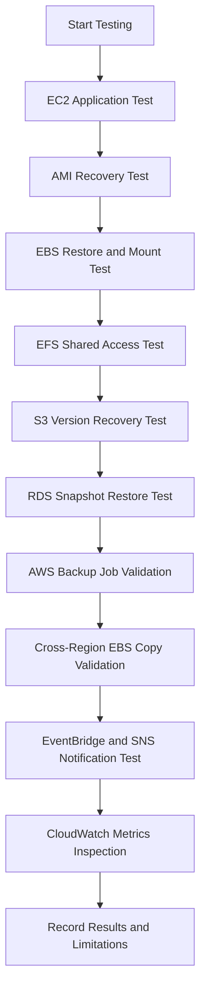

# AWS Backup, Disaster Recovery and Business Continuity – Testing

## 1. Overview

This document records the validation and recovery tests performed during the implementation of the AWS Backup, Disaster Recovery and Business Continuity project.

The tests cover compute recovery, storage access, database restoration, backup jobs, cross-region recovery points and monitoring notifications.

The primary AWS Region is Mumbai (`ap-south-1`). The cross-region backup destination is Singapore (`ap-southeast-1`).

## 2. Testing Objectives

- Verify that application EC2 instances serve the application page.
- Validate recovery using an EC2 AMI.
- Verify EBS recovery-point restoration and volume mounting.
- Validate shared access through EFS.
- Verify S3 object versioning.
- Validate RDS snapshot restoration.
- Confirm AWS Backup job completion.
- Verify cross-region backup availability.
- Confirm backup event notifications.

## 3. Test Summary

| Test ID | Test | Result |
|---|---|---|
| TC-01 | EC2 application availability | Passed |
| TC-02 | EC2 AMI-based recovery | Passed |
| TC-03 | EBS recovery volume attachment and mount | Partially verified |
| TC-04 | EFS shared-file access | Passed |
| TC-05 | S3 object version recovery | Passed |
| TC-06 | RDS snapshot restoration | Passed |
| TC-07 | AWS Backup job completion | Passed |
| TC-08 | Cross-region EBS recovery-point availability | Passed |
| TC-09 | EventBridge and SNS notification delivery | Passed |
| TC-10 | CloudWatch Backup metrics inspection | Inspected |

## 4. Detailed Test Cases

### TC-01: EC2 Application Availability

**Objective:** Verify that the application web page is served by the EC2 instances.

**Resources:**
- `dr-app-server-a`
- `dr-app-server-b`

**Test procedure:**
1. Launch the application EC2 instances.
2. Verify that Apache is installed and running.
3. Access the application through the instance's public address.
4. Confirm that the project web page is displayed.

**Expected result:** The application page should load successfully.

**Observed result:** The application page was served successfully.

**Status:** Passed

### TC-02: EC2 AMI-Based Recovery

**Objective:** Verify that an application server can be recovered from an AMI.

**Resources:**
- Original instance: `dr-app-server-a`
- AMI: `dr-app-server-ami-v1`
- Recovered instance: `dr-recovered-server`

**Test procedure:**
1. Create an AMI from the original application server.
2. Launch `dr-recovered-server` using the AMI.
3. Stop the original application server.
4. Access the application through the recovered instance.
5. Confirm that the application page is served.
6. Restart the original instance.

**Expected result:** The recovered instance should serve the application while the original instance is stopped.

**Observed result:** The recovered instance served the application successfully during the failure simulation.

**Status:** Passed

### TC-03: EBS Recovery Volume

**Objective:** Verify that an EBS recovery point can be restored and mounted on an EC2 instance.

**Resource:** `dr-app-data`

**Test procedure:**
1. Create an EBS recovery point through AWS Backup.
2. Restore the recovery point to a new EBS volume.
3. Attach the restored volume to an EC2 instance.
4. Identify the device using `lsblk`.
5. Mount the restored XFS file system.

The restored volume was identified as `/dev/nvme2n1` and mounted using:

```bash
sudo mkdir -p /mnt/restored-data
sudo mount -o nouuid /dev/nvme2n1 /mnt/restored-data
sudo ls -la /mnt/restored-data
```

**Expected result:** The restored volume should attach and mount successfully.

**Observed result:** The restored volume was attached and mounted. Full verification of the original data contents remains pending.

**Status:** Partially verified

### TC-04: EFS Shared-File Access

**Objective:** Verify that multiple EC2 instances can access the same EFS file system.

**Resource:** `dr-efs`

**Test procedure:**
1. Mount EFS on the application instances.
2. Create a test file from one instance.
3. Read the same file from another instance.
4. Mount EFS on the recovered instance.
5. Verify that the shared file is accessible there as well.

**Expected result:** The same shared file should be accessible from all tested instances.

**Observed result:** Shared-file access was successfully verified across the application instances and recovered instance.

**Status:** Passed

### TC-05: S3 Object Version Recovery

**Objective:** Verify that S3 versioning preserves earlier versions of an object.

**Resource:** `yash-dr-backup-2026`

**Test procedure:**
1. Enable bucket versioning.
2. Upload an object to the bucket.
3. Upload the same object again with different content.
4. Open the object's Versions view.
5. Locate the older version.
6. Download the older version.

**Expected result:** Multiple versions should be available, and the older version should be downloadable.

**Observed result:** Two object versions were visible, and the older version was downloaded successfully.

**Status:** Passed

### TC-06: RDS Snapshot Restoration

**Objective:** Verify that an RDS manual snapshot can be restored to a separate DB instance.

**Resources:**
- Original DB: `dr-mysql`
- Snapshot: `dr-mysql-backup-v1`
- Restored DB: `dr-mysql-restore-test`

**Test procedure:**
1. Create a manual snapshot of the original RDS instance.
2. Restore the snapshot to a separate DB instance.
3. Wait for the restored instance to reach the Available state.
4. Confirm its availability in the RDS console.

**Expected result:** The restored DB instance should become Available.

**Observed result:** `dr-mysql-restore-test` reached the Available state.

**Important limitation:** The original RDS instance did not contain an application database or application records. This test verifies infrastructure-level snapshot restoration, not recovery of application data.

The original RDS instance was not modified during this test.

**Status:** Passed

### TC-07: AWS Backup Job Completion

**Objective:** Verify that AWS Backup can create recovery points for the configured resources.

**Resources tested:**
- `dr-app-server-a`
- `dr-app-server-b`
- `dr-recovered-server`
- `dr-app-data`
- `dr-efs`
- `dr-mysql`
- `dr-mysql-restore-test`

**Test procedure:**
1. Open AWS Backup in the Mumbai Region.
2. Open the Backup jobs section.
3. Review the job status for the configured resources.
4. Confirm successful completion.

**Expected result:** The backup jobs should reach the Completed state.

**Observed result:** Completed backup jobs were observed for the listed resources.

**Status:** Passed

### TC-08: Cross-Region EBS Recovery-Point Availability

**Objective:** Verify that a copied EBS recovery point is available in the Singapore Region.

**Regions:**
- Source: `ap-south-1`
- Destination: `ap-southeast-1`

**Test procedure:**
1. Configure the backup plan's cross-region copy action.
2. Open the AWS Backup console in Singapore.
3. Open the destination backup vault.
4. Locate the copied EBS recovery point.
5. Check its status.

**Expected result:** The copied recovery point should be available in the destination Region.

**Observed result:** The EBS recovery point was verified as Available in Singapore.

**Scope limitation:** This test confirms the EBS recovery point. It does not establish that every configured resource type has a verified cross-region copy.

**Status:** Passed

### TC-09: EventBridge and SNS Notification

**Objective:** Verify that AWS Backup events can trigger email notifications.

**Resources:**
- EventBridge rule: `dr-backup-notification-rule`
- SNS topic: `dr-backup-alerts`

**Test procedure:**
1. Configure the EventBridge rule for backup, copy and restore job state-change events.
2. Configure the SNS topic as its target.
3. Confirm the email subscription.
4. Generate or observe a matching backup event.
5. Check the subscribed email inbox.

**Expected result:** A matching event should result in an email notification.

**Observed result:** The email subscription was confirmed, and a backup notification email was received.

**Status:** Passed

### TC-10: CloudWatch Metrics Inspection

**Objective:** Inspect the AWS Backup metrics namespace.

**Test procedure:**
1. Open Amazon CloudWatch.
2. Navigate to Metrics.
3. Open the `AWS/Backup` namespace.
4. Inspect the available metrics.

**Expected result:** The AWS Backup metrics namespace should be accessible for inspection.

**Observed result:** The namespace was inspected.

**Limitation:** No dedicated CloudWatch dashboard or alarm was created as part of this project.

**Status:** Inspected

## 5. Test Execution Flow



## 6. Important Testing Limitations

The following items were not fully validated:

- Full EBS restored-data content verification.
- Application database and record-level recovery in RDS.
- Full EFS backup restoration from an AWS Backup recovery point.
- Cross-region recovery of every protected resource type.
- Automated application failover between Regions.
- Dedicated CloudWatch dashboards and alarms.
- Full application recovery in the Singapore Region.

These limitations are recorded to distinguish successful infrastructure tests from recovery scenarios that still require validation.

## 7. Conclusion

The project successfully demonstrated EC2 AMI-based recovery, shared EFS access, S3 object version recovery, RDS snapshot restoration, AWS Backup job completion, cross-region EBS recovery-point availability and backup email notifications.

Some recovery scenarios remain partially verified and are documented as limitations rather than being reported as completed tests.

---

**Project:** AWS Backup, Disaster Recovery and Business Continuity  
**Document:** Testing and Validation  
**Primary Region:** `ap-south-1`  
**Backup Destination:** `ap-southeast-1`